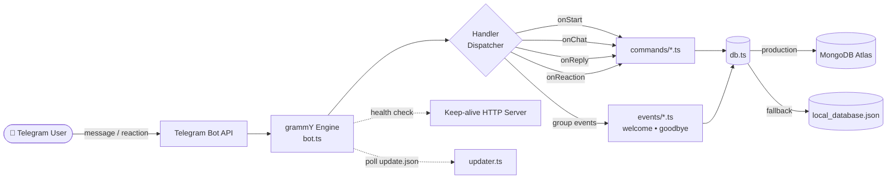

<div align="center">


<br/>


<a href="https://github.com/ItzPihu/TGQueenBot-V2">
  
</a>

<br/><br/>


[](LICENSE)
[](https://github.com/ItzPihu/TGQueenBot-V2)
[](update.json)
[](https://github.com/ItzPihu/TGQueenBot-V2/stargazers)
[](https://github.com/ItzPihu/TGQueenBot-V2/network/members)
[](https://github.com/ItzPihu/TGQueenBot-V2/issues)

<h3>
  <a href="#-quick-start">🚀 Quick Start</a>
  <span> • </span>
  <a href="#-features">✨ Features</a>
  <span> • </span>
  <a href="#-commands">🎮 Commands</a>
  <span> • </span>
  <a href="#-deployment">☁️ Deploy</a>
  <span> • </span>
  <a href="#-contributing">🤝 Contribute</a>
</h3>

</div>

---

## 👑 About

**TGQueenBot-V2** is a next-generation, multipurpose **Telegram bot** built for speed, modularity, and easy customization. It is powered by the latest [grammY](https://grammy.dev/) framework, written in **TypeScript**, and tuned for the [Bun.js](https://bun.sh/) runtime.

Inspired by **GoatBot V2** from the Messenger bot world, it brings the same structured lifecycle system (`onStart`, `onChat`, `onReply`, `onReaction`) to Telegram. Every setting lives in one `config.js` file, so there are no scattered `.env` files and deployment on Render, Railway, Docker, or a VPS is painless.

<div align="center">

| 📦 Project | 👩‍💻 Author | 🧠 Framework | ⚙️ Runtime | 📜 License |
| :---: | :---: | :---: | :---: | :---: |
| TGQueenBot-V2 | [Priyanshi Kaur](https://github.com/ItzPihu) | grammY | Bun.js / Node.js | MIT |

</div>

---

## ✨ Features

<table>
<tr>
<td width="50%" valign="top">

### 🐐 GoatBot V2 Handler System
Rich command metadata (`name`, `aliases`, `version`, `author`, `countDown`, `role`, `category`, `guide`) plus lifecycle hooks: `onStart`, `onChat`, `onReply`, `onReaction`.

### ⚡ Native Bun.js + TypeScript
Runs `.ts` files directly at native speed, with full Node.js (`tsx`) compatibility.

### 🎛️ Centralized `config.js`
Tokens, owner/admin UIDs, MongoDB URI, feature flags, keep-alive server, and updater endpoints in one place.

### 🔥 Hot-Reload Manager (`/cmd`)
Load, unload, reload, or install commands from GitHub, Pastebin, or raw code. Zero restarts.

### 🔄 Built-in Auto-Updater (`/update`)
Checks `update.json`, notifies admins with a changelog, and applies updates with `/update apply`.

</td>
<td width="50%" valign="top">

### 🗑️ Reaction Unsend (`/unsend`)
Reply with `/unsend` or react with 👍 to delete bot messages, with per-group toggles.

### 📊 Cyberpunk Telemetry (`/uptime2`)
A high-resolution Skia/Canvas dashboard that reads real Linux **cgroup** CPU and memory quotas, accurate even on 512 MB Render containers.

### 🎵 YouTube Player (`/play`)
Searches YouTube, converts audio to genuine 192kbps stereo MP3 via FFmpeg for Telegram's native player, and streams MP4 video up to 1080p.

### 🗄️ Hybrid Database (`db.ts`)
MongoDB Atlas in production, with an automatic local JSON fallback (`local_database.json`).

### 🤖 Conversational AI (`/ai`)
Multi-turn Google Gemini assistant with memory, slash commands, passive triggers (`queen`, `ai`), and reply-chain conversations.

</td>
</tr>
</table>

---

## 🏗️ Architecture



---

## 🛠️ Tech Stack

<div align="center">

| Layer | Technology |
| :--- | :--- |
| **Bot Framework** | grammY |
| **Language** | TypeScript |
| **Runtime** | Bun.js (recommended) / Node.js 18+ |
| **Database** | MongoDB Atlas, with local JSON fallback |
| **AI** | Google Gemini |
| **Media** | FFmpeg, ffmpeg-static, YouTube search |
| **Graphics** | Skia Canvas, Canvafy |
| **Hosting** | Render, Railway, Docker, Linux VPS |

</div>

---

## 🎮 Commands

<details open>
<summary><b>🤖 AI & Utility</b></summary>
<br/>

| Command | Description |
| :--- | :--- |
| `/ai` | Conversational Gemini AI with memory and reply chains |
| `/duck` | Keyless DuckDuckGo web search |
| `/wiki` | Wikipedia summaries and article search |
| `/translate` | Multi-language translator |
| `/weather` | Live weather forecast |
| `/crypto` | Live CoinGecko market tracker |

</details>

<details>
<summary><b>🎵 Media</b></summary>
<br/>

| Command | Description |
| :--- | :--- |
| `/play` | YouTube audio (MP3) and video streamer |

</details>

<details>
<summary><b>💰 Economy</b></summary>
<br/>

| Command | Description |
| :--- | :--- |
| `/balance` | Check your wallet |
| `/daily` | Claim your 24-hour reward |
| `/work` | Earn coins with a profession |
| `/gamble` | Multiplier wagering game |
| `/rob` | Risk-reward coin heist |
| `/transfer` | Send coins to other users |
| `/rich` | Group and global wealth leaderboard |

</details>

<details>
<summary><b>🎉 Fun & Social</b></summary>
<br/>

| Command | Description |
| :--- | :--- |
| `/8ball` | Magic 8-Ball fortune teller |
| `/confess` | Compatibility ship and confession card |
| `/couple` | Group matchmaker with anime hug GIFs |
| `/rank` | Leveling system with rank card |

</details>

<details>
<summary><b>🛡️ Moderation</b></summary>
<br/>

| Command | Description |
| :--- | :--- |
| `/kick` | Remove a member from the group |
| `/mute` | Duration-based member restriction |
| `/warn` | 3-strike warning with auto-kick |

</details>

<details>
<summary><b>⚙️ System & Owner</b></summary>
<br/>

| Command | Description |
| :--- | :--- |
| `/start` | Interactive welcome dashboard |
| `/help` | Categorized command directory |
| `/getid` | User, chat, and message ID inspector |
| `/uptime` | Text-based runtime status |
| `/uptime2` | Cyberpunk canvas telemetry dashboard |
| `/unsend` | Delete bot messages |
| `/admin` | Manage owners and administrators |
| `/cmd` | Dynamic command loader and installer |
| `/update` | Version checker and auto-updater |
| `/restart` | Reboot the bot process |

</details>

---

## 🔐 Role Permission Hierarchy

<div align="center">

| Level | Tier | Access |
| :---: | :--- | :--- |
| 🟢 `0` | **Public** | Standard commands for every member in private and group chats |
| 🟡 `1` | **Group Admins** | Moderation (`/kick`, `/mute`, `/warn`) for group admins, creators, and bot admins |
| 🔴 `2` | **Bot Owners & Admins** | System commands (`/cmd`, `/admin`, `/update`, `/restart`) for UIDs in `config.roles` |

</div>

---

## 🚀 Quick Start

### 📋 Prerequisites

- [Bun.js](https://bun.sh/) `v1.0.0+` (recommended) or [Node.js](https://nodejs.org/) `v18.0.0+`
- A **Telegram Bot Token** from [@BotFather](https://t.me/BotFather)
- *(Optional)* **MongoDB URI**: local JSON storage is used if omitted
- *(Optional)* **FFmpeg**: `play.ts` falls back to `ffmpeg-static` automatically

### 1️⃣ Clone

```bash
git clone https://github.com/ItzPihu/TGQueenBot-V2.git
cd TGQueenBot-V2
```

### 2️⃣ Install

```bash
# Bun (recommended)
bun install

# or npm
npm install
```

### 3️⃣ Configure `config.js`

```javascript
export const config = {
  bot: {
    name: "TGQueenBot-V2",
    author: "Priyanshi Kaur",
    version: "2.0.0",
    prefix: "/",
    token: "YOUR_TELEGRAM_BOT_TOKEN"
  },
  roles: {
    owners: [123456789],   // your Telegram user ID
    admins: [123456789]
  },
  database: {
    type: "mongodb",
    uri: "YOUR_MONGODB_URI_OR_LEAVE_EMPTY_FOR_LOCAL_JSON",
    dbName: "Queen"
  },
  server: {
    port: 3000,
    keepAlive: true,
    pingInterval: 840000,
    externalUrl: ""
  },
  updater: {
    enabled: true,
    updateUrl: "https://raw.githubusercontent.com/ItzPihu/TGQueenBot-V2/main/update.json",
    checkInterval: 3600000,
    autoNotifyAdmins: true
  },
  features: {
    rankUpNotification: true,
    welcomeMessage: true,
    goodbyeMessage: true,
    weeklyReport: { enabled: true, cronSchedule: "0 0 * * 0" },
    cooldowns: true,
    whitelist: { enabled: false, allowedUsers: [] }
  }
};

export default config;
```

> [!WARNING]
> Never commit your real bot token or MongoDB URI to a public repository. Keep secrets out of version control before pushing.

### 4️⃣ Run

```bash
# Bun.js
bun start

# Node.js
npm run start:node
```

---

## 🧩 Create Your Own Command

Every file in `commands/` follows the same GoatBot V2 style template:

```typescript
export const config_data = {
  name: "example",
  aliases: ["ex", "demo"],
  version: "2.0.0",
  author: "Priyanshi Kaur",
  countDown: 5,
  role: 0,
  shortDescription: { en: "Short summary of what the command does" },
  longDescription:  { en: "Detailed explanation of the command functionality" },
  category: "Utility",
  guide: { en: "/example <arguments>" }
};

export async function onStart({ bot, ctx, args, db, message }: any): Promise<void> {
  await ctx.reply("Hello from TGQueenBot-V2!");
}

export async function onChat({ bot, ctx, db, message }: any): Promise<void> {}
export async function onReply({ bot, ctx, Reply, args, db }: any): Promise<void> {}
export async function onReaction({ bot, ctx, db }: any): Promise<void> {}

export default { config: config_data, onStart, onChat, onReply, onReaction };
```

Drop the file into `commands/`, then run `/cmd load example.ts` to activate it instantly.

---

## 🧰 Built-In System Managers

<table>
<tr>
<td width="33%" valign="top">

### 🔥 `/cmd`
- `/cmd load <file>`: hot-load one script
- `/cmd loadall`: reload everything
- `/cmd unload <name>`: unload a command
- `/cmd install <url> <file.ts>`: install from GitHub or Pastebin
- `/cmd install <file.ts> <code>`: install from pasted code

Overwrites ask for 👍 reaction confirmation.

</td>
<td width="33%" valign="top">

### 🔄 `/update`
- `/update check`: compare with remote `update.json` and show the changelog
- `/update apply`: `git pull`, install dependencies, restart

</td>
<td width="33%" valign="top">

### 🗑️ `/unsend`
- Reply to a bot message with `/unsend` or `/del`
- React with 👍 to delete it
- `/unsend react on | off | status` toggles per chat

</td>
</tr>
</table>

---

## ☁️ Deployment

<details>
<summary><b>🟣 Render (Web Service)</b></summary>
<br/>

1. Fork or push this repo to your GitHub account.
2. Create a new **Web Service** on [Render](https://render.com/) and connect the repo.
3. **Build Command:** `bun install` (or `npm install`)
4. **Start Command:** `bun run bot.ts` (or `npm start`)
5. Fill in `config.js`. The built-in HTTP server on `config.server.port` handles health checks and keep-alive pings.

</details>

<details>
<summary><b>🐳 Docker / 🖥️ VPS / 🚂 Railway</b></summary>
<br/>

The bot only needs Bun (or Node 18+) and your `config.js`. Install dependencies, then run `bun run bot.ts`. Use a process manager such as `pm2` or `systemd` on a VPS to keep it alive.

</details>

---

## 🗂️ Project Structure

<details>
<summary><b>Click to expand</b></summary>

```text
TGQueenBot-V2/
├── assets/          # Fonts, fallback avatars, branding images
├── commands/        # GoatBot V2 style command scripts (30 commands)
├── events/          # welcome.ts, goodbye.ts (Canvafy cards)
├── temp/            # Ephemeral media transcoding directory
├── bot.ts           # Core grammY engine and handler dispatcher
├── config.js        # Centralized settings, roles, feature toggles
├── db.ts            # MongoDB and local JSON fallback layer
├── updater.ts       # Remote update.json checker and git pull executor
├── update.json      # Version manifest and release changelog
├── package.json     # Dependencies and Bun/Node scripts
└── tsconfig.json    # TypeScript configuration
```

</details>

---

## 🤝 Contributing

Contributions, bug reports, and new command ideas are welcome.

1. 🍴 Fork the repository
2. 🌿 Create a branch: `git checkout -b feature/awesome-command`
3. 💾 Commit your changes: `git commit -m "Add awesome command"`
4. 📤 Push: `git push origin feature/awesome-command`
5. 🔃 Open a Pull Request

---

## 🙏 Credits

- 👩‍💻 **Author & Lead Developer:** [Priyanshi Kaur](https://github.com/ItzPihu)
- 🧠 **Framework:** [grammY](https://grammy.dev/)
- 🐐 **Architectural Inspiration:** GoatBot V2 by NTKhang

## 📜 License

Released under the **MIT License**. See the [`LICENSE`](LICENSE) file for details.

---

<div align="center">

### ⭐ If you like this project, give it a star!

[](https://github.com/ItzPihu/TGQueenBot-V2/stargazers)

Made with 💖 by [Priyanshi Kaur](https://github.com/ItzPihu)


</div>
